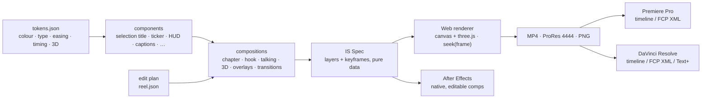

<p align="center">
  
</p>

<h3 align="center">A motion design system you can render.</h3>

<p align="center">
  Graph-paper daylight, blacked-out night footage and one signal red.<br>
  Titles move like objects selected in a design tool, tickers keep the beat, handwriting keeps it human — in 2D and 3D.
</p>

<p align="center">
  
  
  
  
  
  
  
</p>

---

**Ink & Signal** is a library for making Instagram Reels and YouTube videos that all look like they came from the same
studio. Every graphic is code: a deterministic runtime renders it frame by frame in the browser, and the same data
rebuilds it in **After Effects**, **Premiere Pro** and **DaVinci Resolve** — by hand or through their MCP servers.
It ships with a `SKILL.md`, so Claude can cut your reels with it.

## Reels

<table>
  <tr>
    <td align="center" width="33%"><br><b>Chapter card</b><br><code>chapter</code></td>
    <td align="center" width="33%"><br><b>Hook / intro</b><br><code>hook</code></td>
    <td align="center" width="33%"><br><b>Captions & callouts</b><br><code>talking</code></td>
  </tr>
  <tr>
    <td align="center"><br><b>3D pop-up paper</b><br><code>3d-popup</code></td>
    <td align="center"><br><b>3D polaroid fly-through</b><br><code>3d-polaroids</code></td>
    <td align="center"><br><b>End card</b><br><code>endcard</code></td>
  </tr>
</table>

## YouTube

<table>
  <tr>
    <td align="center" width="50%"><br><b>3D gizmo title</b> · <code>3d-title</code></td>
    <td align="center" width="50%"><br><b>3D ticker ring</b> · <code>3d-ring</code></td>
  </tr>
  <tr>
    <td align="center"><br><b>Chapter card</b> · <code>chapter</code></td>
    <td align="center"><br><b>Lower third + B-roll</b> · <code>lowerthird</code></td>
  </tr>
  <tr>
    <td align="center"><br><b>3D paper roll transition</b> · <code>tr-paper-roll</code></td>
    <td align="center"><br><b>Torn-paper wipe</b> · <code>tr-torn</code></td>
  </tr>
</table>

## Quick start

```bash
git clone https://github.com/AkashKhairal/ink-signal.git && cd ink-signal
npm install && npx playwright install chromium     # headless renderer (ffmpeg + python3/numpy on PATH too)

node render/serve.mjs                               # live gallery + scrubbable stage in your browser
node render/cli.mjs list                            # every composition and what it does
node render/cli.mjs render chapter --format reel \
  --params '{"title":"Setup","sub":"Light · Desk · Cam"}' --out chapter.mp4
node render/cli.mjs render ov-lowerthird --format yt --out lowerthird.mov       # transparent ProRes 4444
node render/cli.mjs render 3d-title --format yt --params '{"text":"Done"}' --blur 4 --out done.mp4
```

A whole reel — your clips, captions, transitions, music — from one plan file:

```bash
python3 render/beats.py track.mp3 --out beats.json         # tempo, beats, downbeats, the drop
python3 tools/words.py talk.srt --out words.json           # transcript → word-timed captions
node render/build-reel.mjs examples/reel.plan.json --out reel.mp4 --beats   # cuts on downbeats, −14 LUFS
```

## How it works



- **Deterministic.** `seek(frame)` is a pure function of time: no clocks, no `Math.random`, no CSS animations.
  Render a frame twice and you get the same pixels.
- **One source of truth.** [`tokens/ink-signal.tokens.json`](tokens/ink-signal.tokens.json) holds every colour, font,
  easing curve, duration and 3D rule. The web runtime, the After Effects adapter and the Resolve adapter all read it.
- **Same layout everywhere.** Text is laid out from the fonts' real metrics, so a selection box fits its title in the
  browser and in After Effects.
- **Real motion blur.** `--blur N` renders N subframes per frame and averages them.
- **Real footage.** Clips are pre-extracted to frame-exact image sequences, so any codec works and seeking is exact.

## The system

<p align="center"></p>

| Beat | Frames @30 | Ease |
|---|---|---|
| Selection box draws | 6 | `snap` (.16, 1, .3, 1) |
| Handles pop | 4 | `stamp` (.34, 1.56, .64, 1) — the only overshoot |
| Title lands 112 % → 100 % | 12 | `snap` |
| HUD type-on | 1 per character | linear |
| Glyph stamp (star · sparkle · plus) | 8, staggered 3 | `stamp` |
| Handwriting write-on / arrow | 18 / 12 | `write` |
| Torn-paper wipe | 10 in · 2 covered · 10 out | `wipe` |
| Ticker | 120 px/s forever | linear, never eases |

**Rules.** One loud colour. Titles are one or two words in Archivo Expanded Black. Footage behind titles is blurred,
darkened and pushed in; A-roll stays clean. Cuts land on downbeats. No gradients on type, glows, lens flares,
camera shake or emoji. The full spec is in [`docs/MOTION-SPEC.md`](docs/MOTION-SPEC.md); structures for 15/30/60-second
reels and YouTube videos are in [`docs/RECIPES.md`](docs/RECIPES.md).

### 3D

Extruded type with signal-red faces and ink sides, a long lens (28°), a key light from the top-left — the same
direction that lights the crumpled paper — and the selection gizmo as the hero device. Cameras move on the `wipe`
curve, then hold on `drift`. Scenes: `gizmoTitle`, `popupPaper`, `tickerRing`, `polaroidFlythrough`, `paperRoll`.

## Compositions

| Name | Kind | What it is |
|---|---|---|
| `chapter` | title | Blurred night footage, HUD corners, two tickers, title in a selection box, wiped subtitle, 2-frame flash |
| `hook` | title | Graph paper, word rises letter by letter with your cutout as a letter, handwritten aside, torn night panel with polaroids |
| `talking` | a-roll | Word captions (active word on a red plate), step chip, callout box, note + arrow, punch word |
| `lowerthird` | a-roll | REC timecode, notebook card, B-roll polaroid, two-bar lower third |
| `endcard` | title | Paper sign-off: letter rise, YouTube end-screen slots or a follow CTA, contact row |
| `3d-title` · `3d-popup` · `3d-ring` · `3d-polaroids` | 3D | three.js scenes with the 2D system layered on top |
| `ov-title` · `ov-captions` · `ov-lowerthird` · `ov-ticker` · `ov-hud` · `ov-callout` · `ov-chip` · `ov-punch` · `ov-note` | overlay | Transparent, for your own footage in any editor |
| `tr-torn` · `tr-flash` · `tr-ticker` · `tr-paper-roll` | transition | The cut sits under the frames where the screen is covered |
| `edit` | sequence | A whole video from an edit plan, cuts optionally snapped to the beat |

Formats: `reel` 1080×1920 · `yt` 1920×1080 · `square` 1080×1080 · `portrait` 1080×1350 · 30 fps (24 and 60 work).

## The edit plan

```json
{
  "name": "desk-setup", "format": "reel", "fps": 30, "accent": "#F2362B",
  "audio": { "music": "music/track.mp3", "musicGainDb": -9, "lufs": -14 },
  "snap": "downbeat",
  "timeline": [
    { "type": "comp", "comp": "hook", "duration": 3, "params": { "word": "Hell", "note": "yep, that's me" } },
    { "type": "transition", "comp": "tr-torn" },
    { "type": "clip", "src": "clips/talk.mp4", "in": 4.2, "out": 9.8,
      "overlays": [ { "comp": "ov-captions", "params": { "words": [ { "text": "First", "start": 0.1, "end": 0.45 } ] } } ] },
    { "type": "comp", "comp": "chapter", "duration": 2.4, "params": { "title": "Light", "src": "clips/lamp.mp4" } },
    { "type": "transition", "comp": "tr-flash" },
    { "type": "comp", "comp": "endcard", "duration": 3 }
  ]
}
```

## After Effects · Premiere Pro · DaVinci Resolve

```bash
node render/nle.mjs plan.json --out pkg   # renders/ (ProRes 422 HQ, 4444 + alpha) · manifest.json · timeline.xml · edit.spec.json · plates/
```

| | No scripting | Scripted or through an MCP server |
|---|---|---|
| **After Effects** | Import `pkg/renders/*.mov` | `$.evalFile(".../InkSignal.jsx"); InkSignal.buildFromPackage("/abs/pkg")` rebuilds **native, editable comps**: real text layers, shape layers, keyframes with the exact Ink & Signal curves, text animators, masks, precomps |
| **Premiere Pro** | File › Import › `pkg/timeline.xml` | `InkSignalPPro.assemble("/abs/pkg")` through the MCP's ExtendScript tool, or its import + timeline tools with `manifest.json` |
| **DaVinci Resolve** | File › Import › Timeline › `pkg/timeline.xml` | `assemble("/abs/pkg")` through the MCP's Python tool · `add_title("Setup")` for native Fusion Text+ |

Details and exact MCP calls: [`integrations/after-effects`](integrations/after-effects) ·
[`integrations/premiere-pro`](integrations/premiere-pro) · [`integrations/davinci-resolve`](integrations/davinci-resolve).

## Use it with Claude

Attach the repo (or a zip of it) and ask: *"Make this reel with Ink & Signal: clips in `~/Videos/reel-12`, transcript
`talk.srt`, music `track.mp3`."* [`SKILL.md`](SKILL.md) tells Claude the workflow: analyse the song and the
transcript, storyboard on the beat grid, write the plan, review a contact sheet, render, and hand off to your editor.

Need something the templates don't cover? Build it from [`runtime/components.js`](runtime/components.js), add a 3D scene
with [`runtime/three/kit.js`](runtime/three/kit.js), or write a one-off GSAP scene from
[`examples/bespoke-gsap.html`](examples/bespoke-gsap.html) — the timeline stays paused and is seeked frame by frame.

## Layout

```
tokens/        ink-signal.tokens.json (source of truth) · tokens.css
fonts/         Archivo Expanded, Archivo, Caveat, JetBrains Mono (OFL) + 3D typeface
runtime/       core · spec · components · render2d · player · three/ · comps/ · gsap-bridge
stage/         the page that renders any comp, spec or plan
render/        cli.mjs · build-reel.mjs · nle.mjs · beats.py · serve.mjs
integrations/  after-effects/ · premiere-pro/ · davinci-resolve/
docs/          MOTION-SPEC.md · RECIPES.md · library.html (live gallery)
examples/      demo.plan.json · reel.plan.json · bespoke-gsap.html
tools/         build.py (tokens → runtime/CSS/Python) · words.py · ttf_to_typeface.py
```

After editing `tokens/ink-signal.tokens.json`, run `python3 tools/build.py` to regenerate the derived files.

## Credits & licence

Code: MIT. Fonts: [Archivo](https://github.com/Omnibus-Type/Archivo), [Caveat](https://github.com/googlefonts/caveat)
and [JetBrains Mono](https://github.com/JetBrains/JetBrainsMono), SIL Open Font License 1.1 (static instances in
`fonts/`). [three.js](https://threejs.org) (MIT). [GSAP](https://gsap.com) (GreenSock standard no-charge licence).
Rendering pipeline ideas from the community collection
[awesome-opus5-5-videos](https://github.com/yihui-dev/awesome-opus5-5-videos).
The visual language was inspired by Raagav Sundar's *Graphic Design Portfolio 2026* on Behance; no artwork from it is
included.
