<p align="center">
  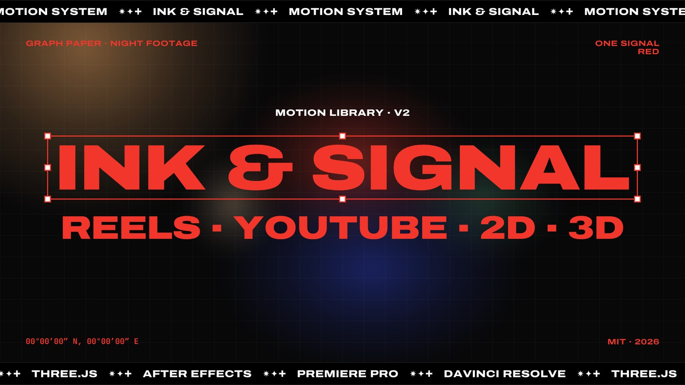
</p>

<h3 align="center">A motion design system you can render.</h3>

<p align="center">
  Graph-paper daylight, blacked-out night footage and one signal red.<br>
  Titles move like objects selected in a design tool, product UI glides on springs, tickers keep the beat,
  handwriting keeps it human — in 2D and 3D, with sound.
</p>

<p align="center">
  
  
  
  
  
  
  
  
  
</p>

---

**Ink & Signal** is a library for making Instagram Reels, YouTube videos and SaaS explainers that all look like they
came from the same studio. Every graphic is code: a deterministic runtime renders it frame by frame in the browser,
and the same data rebuilds it in **After Effects**, **Premiere Pro** and **DaVinci Resolve**. It ships with Claude
skills, so Claude can cut your reels, build your product video, add motion B-roll to your talking head and mix the
sound — in your brand, with your accent colour.

**New in v3** — the **Signal Motion engine** (springs, a camera, a cursor, a rounded *interface layer* for product UI,
charts and kinetic type) and 42 new scenes on top of it: three explainer templates, eleven B-roll clips, eight
infographics, six card animations, nine kinetic titles and four object transitions. Plus a measured sound pass with
103 CC0 sounds, a B-roll pipeline for talking-head videos and titles that sit behind the subject.

## Explainers

Full product videos from one params file: a beat-locked hype promo, a calm homepage demo with the product UI rebuilt
and filmed up close, and a one-take loop. [Guide →](docs/EXPLAINERS.md)

<table>
  <tr>
    <td align="center" colspan="2">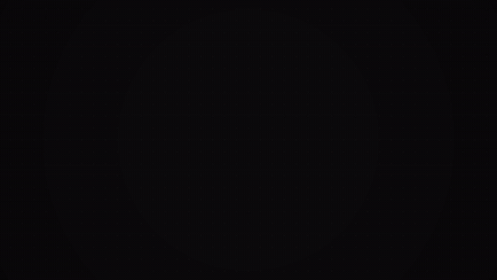<br><b>Hype promo</b> · <code>x-hype</code> · 15 s on 8 bars at 128 BPM, HUD viewfinder, 3D signature</td>
  </tr>
  <tr>
    <td align="center" width="50%">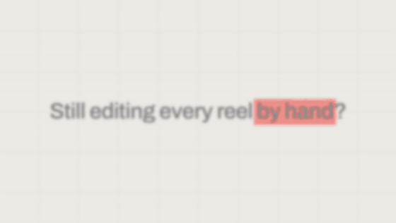<br><b>Product demo</b> · <code>x-demo</code> · 30–90 s, the camera is the editor</td>
    <td align="center" width="50%">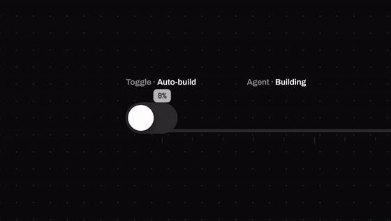<br><b>One-take journey</b> · <code>x-journey</code> · a seamless loop</td>
  </tr>
</table>

## Motion B-roll

One shape that never cuts: it morphs from state to state while a cursor drives real clicks and drags, and every
change lands on a spoken word. Full-frame cutaways or transparent panels for a talking-head video, with timing notes,
a preview of your video with the clips cut in and a review page. [Guide →](docs/BROLL.md)

<table>
  <tr>
    <td align="center" width="50%">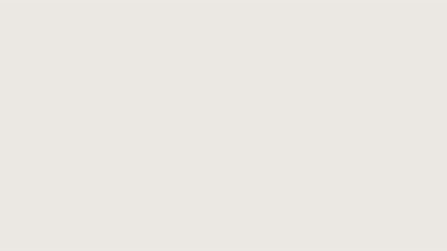<br><b>Launch: pill → card → picker</b> · <code>mb-launch</code></td>
    <td align="center" width="50%">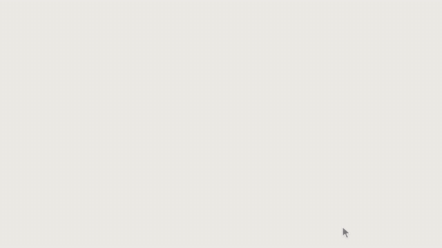<br><b>Folder → terminal → agent</b> · <code>mb-terminal</code></td>
  </tr>
  <tr>
    <td align="center">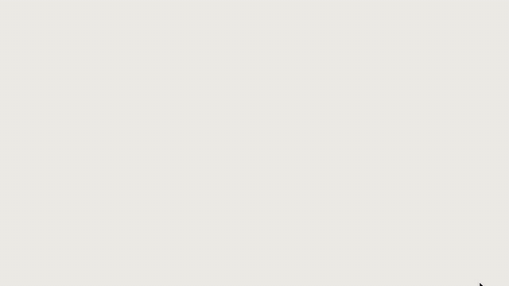<br><b>Slider builds a result</b> · <code>mb-slider</code></td>
    <td align="center"><br><b>Side by side + verdict</b> · <code>mb-versus</code></td>
  </tr>
</table>

<table>
  <tr>
    <td align="center" width="33%">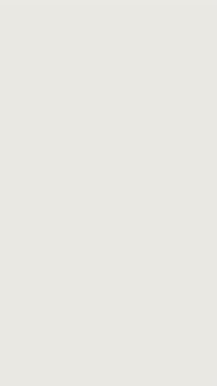<br><b>Search → filter → pick</b><br><code>mb-search</code></td>
    <td align="center" width="33%">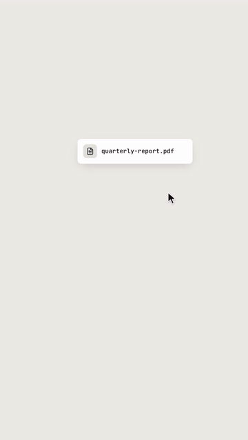<br><b>Drag → drop → upload</b><br><code>mb-drop</code></td>
    <td align="center" width="33%">Also: <code>mb-doc</code> notes → doc → drag into a session · <code>mb-checklist</code> · <code>mb-chart</code> · <code>mb-chapter</code> · <code>mb-toggles</code><br><br>Every clip renders at your video's size and frame rate, as MP4 or transparent ProRes 4444.</td>
  </tr>
</table>

## Infographics

Real numbers only: bars on springs, odometers that carry digits, lines drawing behind a leading dot, one accent.

<table>
  <tr>
    <td align="center" width="50%">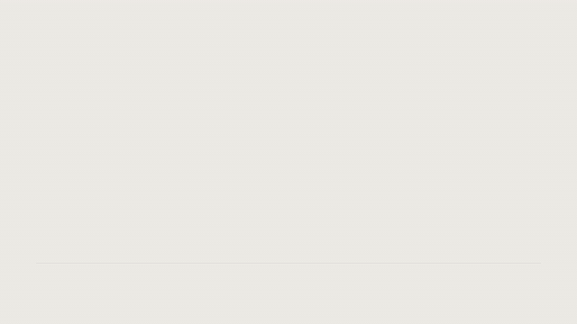<br><b>Bar chart</b> · <code>ig-bars</code></td>
    <td align="center" width="50%">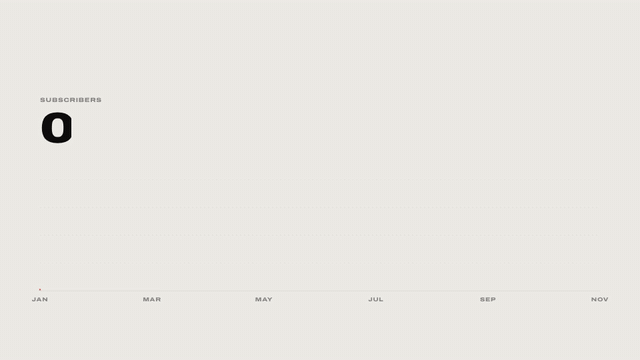<br><b>Line + headline number</b> · <code>ig-line</code></td>
  </tr>
  <tr>
    <td align="center">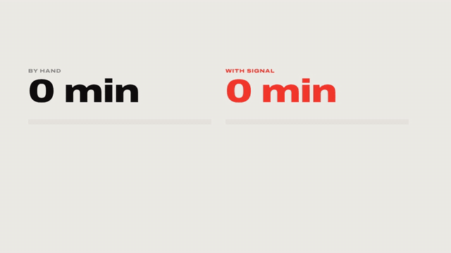<br><b>Before / after</b> · <code>ig-compare</code></td>
    <td align="center">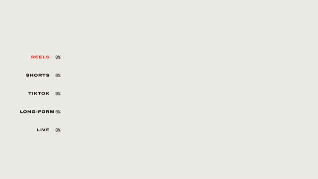<br><b>Ranking race</b> · <code>ig-ranking</code></td>
  </tr>
  <tr>
    <td align="center" colspan="2"><br><b>Process / how it works</b> · <code>ig-flow</code></td>
  </tr>
</table>

<table>
  <tr>
    <td align="center" width="33%">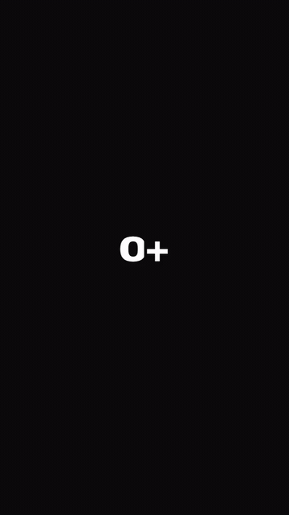<br><b>Big number</b><br><code>ig-counter</code></td>
    <td align="center" width="33%">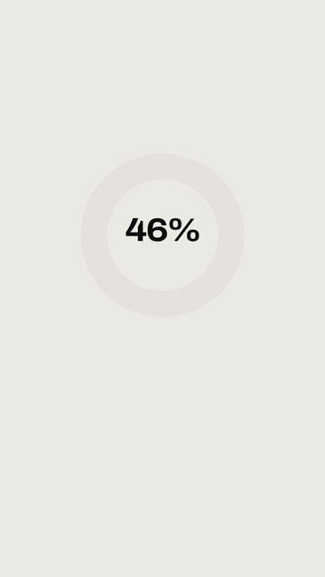<br><b>Donut + legend</b><br><code>ig-donut</code></td>
    <td align="center" width="33%">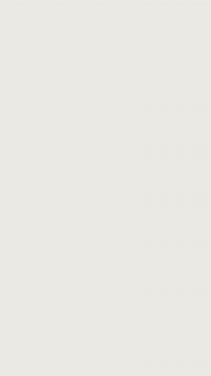<br><b>Timeline</b><br><code>ig-timeline</code></td>
  </tr>
</table>

## Cards

<table>
  <tr>
    <td align="center" width="50%">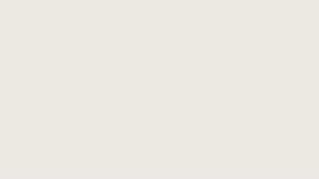<br><b>Bento grid</b> · <code>card-bento</code></td>
    <td align="center" width="50%"><br><b>Card flip</b> · <code>card-flip</code></td>
  </tr>
  <tr>
    <td align="center" colspan="2"><br><b>Deal a hand</b> · <code>card-deal</code></td>
  </tr>
</table>

<table>
  <tr>
    <td align="center" width="33%">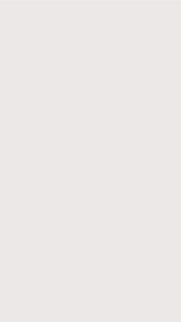<br><b>Stack flick-through</b><br><code>card-stack</code></td>
    <td align="center" width="33%"><br><b>Notification stack</b><br><code>card-notify</code></td>
    <td align="center" width="33%"><br><b>Quote</b><br><code>card-quote</code></td>
  </tr>
</table>

## Kinetic titles

<table>
  <tr>
    <td align="center" width="50%"><br><b>Brand slam</b> · <code>t-slam</code></td>
    <td align="center" width="50%">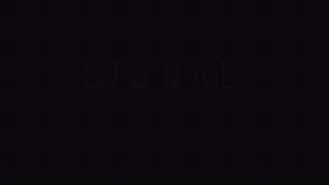<br><b>Weight / width morph</b> · <code>t-morph</code></td>
  </tr>
  <tr>
    <td align="center"><br><b>Signal decode</b> · <code>t-decode</code></td>
    <td align="center">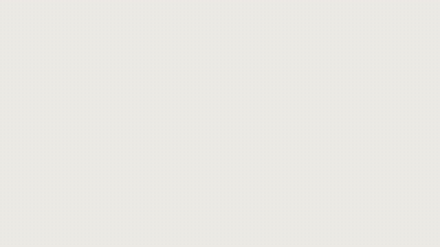<br><b>Line + push-in + highlight</b> · <code>t-highlight</code></td>
  </tr>
  <tr>
    <td align="center" colspan="2">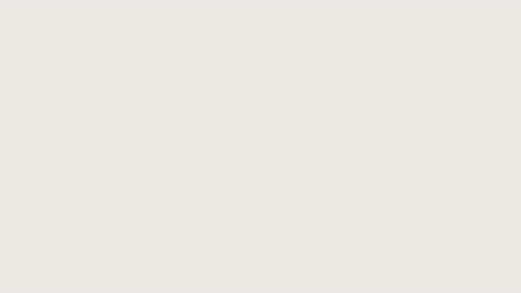<br><b>Rotating word</b> · <code>t-rotator</code></td>
  </tr>
</table>

<table>
  <tr>
    <td align="center" width="33%">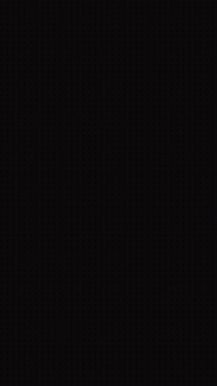<br><b>Outline wall + slam</b><br><code>t-wall</code></td>
    <td align="center" width="33%">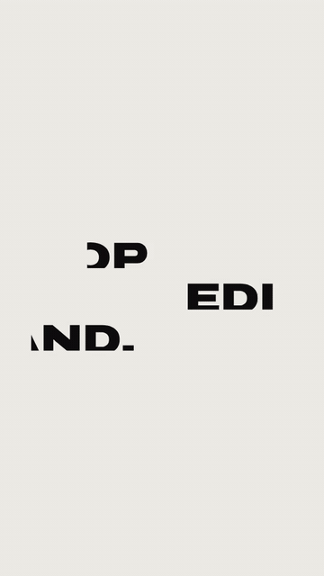<br><b>Stacked lines</b><br><code>t-stack</code></td>
    <td align="center" width="33%"><br><b>Countdown</b><br><code>t-countdown</code></td>
  </tr>
</table>

Plus **`t-behind`**: a huge word rises between the background and the person in your shot, cut out frame by frame
with SAM 2 or a chroma key (`tools/separate.py`).

## Object transitions

<p align="center">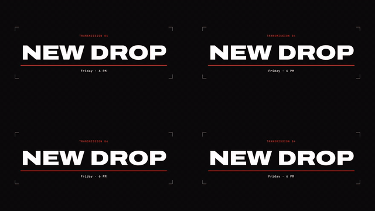</p>
<p align="center"><code>tr-flood</code> · <code>tr-dot</code><br><code>tr-bars</code> · <code>tr-zoom</code><br>Transparent ProRes 4444 with a <code>CUT</code> marker where the frame is covered.</p>

## Titles, overlays and 3D (IS Spec)

The original Ink & Signal compositions: rebuilt natively in After Effects, with real text layers and keyframes.

<table>
  <tr>
    <td align="center" width="33%">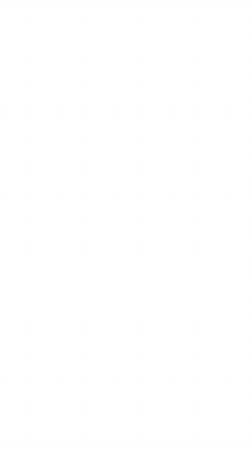<br><b>Chapter card</b><br><code>chapter</code></td>
    <td align="center" width="33%">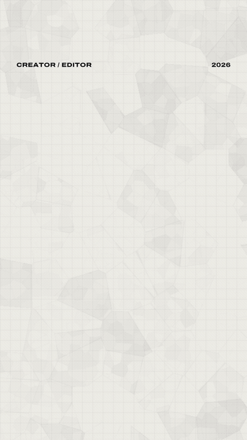<br><b>Hook / intro</b><br><code>hook</code></td>
    <td align="center" width="33%">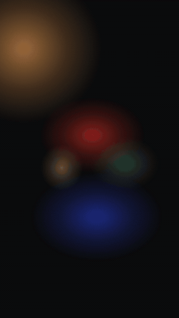<br><b>Captions & callouts</b><br><code>talking</code></td>
  </tr>
  <tr>
    <td align="center">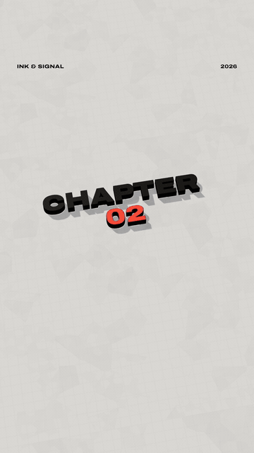<br><b>3D pop-up paper</b><br><code>3d-popup</code></td>
    <td align="center">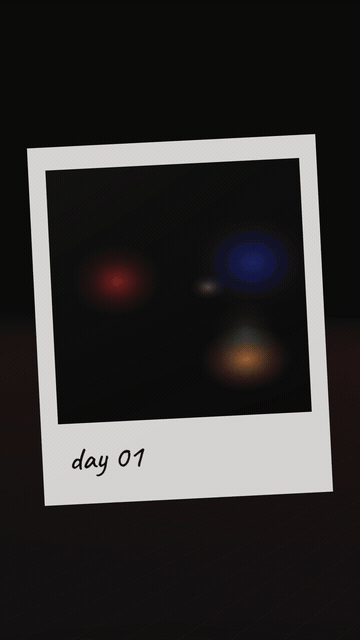<br><b>3D polaroid fly-through</b><br><code>3d-polaroids</code></td>
    <td align="center">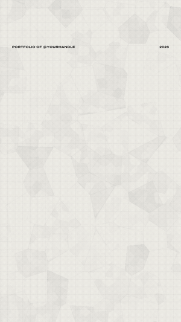<br><b>End card</b><br><code>endcard</code></td>
  </tr>
</table>

<table>
  <tr>
    <td align="center" width="50%">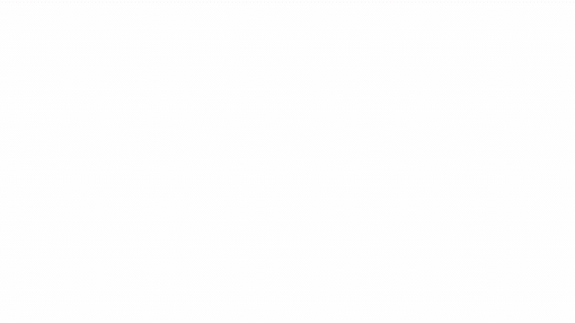<br><b>3D gizmo title</b> · <code>3d-title</code></td>
    <td align="center" width="50%">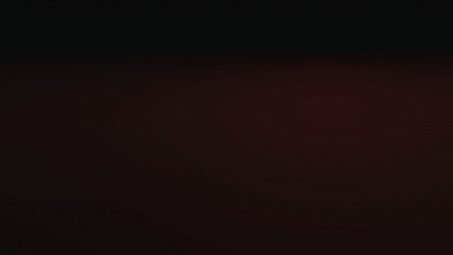<br><b>3D ticker ring</b> · <code>3d-ring</code></td>
  </tr>
  <tr>
    <td align="center">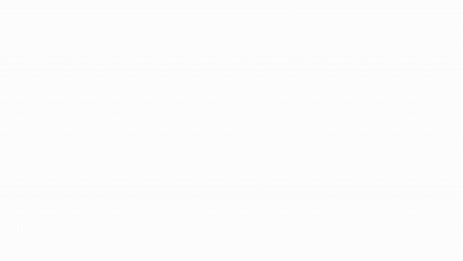<br><b>Chapter card</b> · <code>chapter</code></td>
    <td align="center">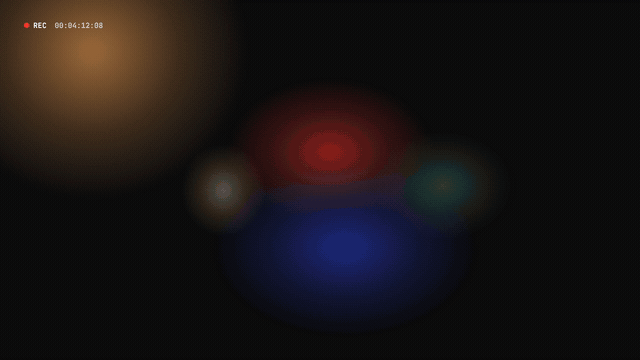<br><b>Lower third + B-roll</b> · <code>lowerthird</code></td>
  </tr>
  <tr>
    <td align="center">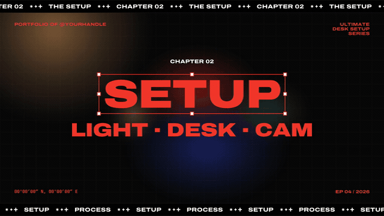<br><b>3D paper roll transition</b> · <code>tr-paper-roll</code></td>
    <td align="center">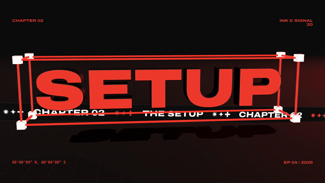<br><b>Torn-paper wipe</b> · <code>tr-torn</code></td>
  </tr>
  <tr>
    <td align="center">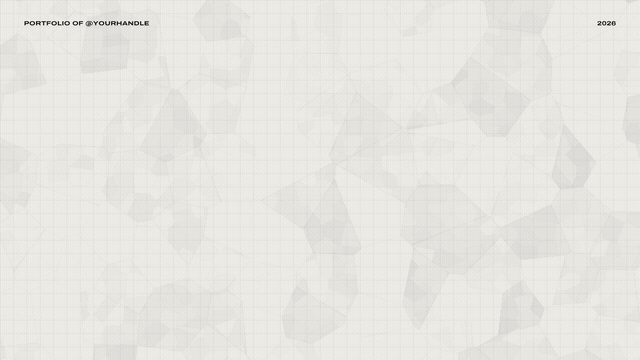<br><b>End card</b> · <code>endcard</code></td>
    <td align="center">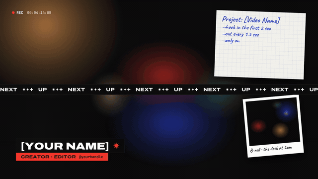<br><b>Ticker wipe</b> · <code>tr-ticker</code></td>
  </tr>
</table>

Every template, its formats and its params: [`docs/CATALOG.md`](docs/CATALOG.md).

## Quick start

```bash
git clone https://github.com/AkashKhairal/ink-signal.git && cd ink-signal
npm install && npx playwright install chromium     # headless renderer (ffmpeg + python3 with numpy, Pillow on PATH)

node render/serve.mjs                               # live gallery + scrubbable stage in your browser
node render/cli.mjs list                            # every template and what it does

# a title, an infographic, a product promo
node render/cli.mjs render t-slam --format reel --params '{"text":"Orbit","kicker":"Introducing — 2026"}' --out slam.mp4
node render/cli.mjs render ig-bars --format yt --params-file my-chart.json --blur 4 --out chart.mp4
node render/cli.mjs render x-hype --format yt --params '{"product":"Orbit","accent":"#2B6BF2"}' --blur 4 --out promo.mp4

# look before you render: a contact sheet of 9 moments
node render/cli.mjs sheet x-demo --params-file demo.json --auto 9 --out check.png

# overlays and transitions with alpha
node render/cli.mjs render tr-flood --format yt --params '{"transparent":true}' --out flood.mov   # ProRes 4444 + .markers.json
```

A whole reel — your clips, captions, motion scenes, transitions, music — from one plan file:

```bash
python3 render/beats.py track.mp3 --out beats.json         # tempo, beats, downbeats, the drop
python3 tools/words.py talk.srt --out words.json           # transcript → word-timed captions
node render/build-reel.mjs examples/reel.plan.json --out reel.mp4 --beats   # cuts on downbeats, −14 LUFS
```

Sound on anything, measured:

```bash
node render/cli.mjs render x-hype --blur 4 --out promo_silent.mp4          # also writes promo_silent.cues.json
python3 render/sound.py --video promo_silent.mp4 --cues promo_silent.cues.json \
  --music track.mp3 --music-source "…" --music-license "…" --align --out sound/
# → sound/after.mp4 (−14 LUFS, < −1.5 dBTP), beatgrid.png, cue proofs, report.html (swap any sound), CREDITS.txt
```

## Use it with Claude

Attach the repo (or a zip of it) to a Claude project and ask in plain words. [`SKILL.md`](SKILL.md) routes the request
to one of four skills in [`skills/`](skills):

| Ask | Skill | What Claude does |
|---|---|---|
| *"Make a Reel from these clips, transcript and track."* | [`ink-signal-reels`](skills/ink-signal-reels/SKILL.md) | beats + words → storyboard on the beat grid → edit plan mixing clips, titles, infographics and transitions → review sheet → render → NLE package |
| *"Make a 15-second launch promo for my app"* / *"a 60-second homepage demo"* | [`ink-signal-explainer`](skills/ink-signal-explainer/SKILL.md) | reads your site, writes the beat sheet, fills the template params with your real wording, draft → final → sound |
| *"Add motion graphics to my talking-head video."* | [`ink-signal-broll`](skills/ink-signal-broll/SKILL.md) | inspects the layout, plans clips on your words, renders cutaways or panels, preview + review page |
| *"Add sound effects and music, ready to post."* | [`ink-signal-sound`](skills/ink-signal-sound/SKILL.md) | licence check, cue list, beat grid, one real sound per cue, measured mix, five timestamps to check |

The rules Claude follows are the brand's: one loud colour, real numbers only, no invented testimonials or logos, and
a contact sheet it actually looks at before every render.

## How it works

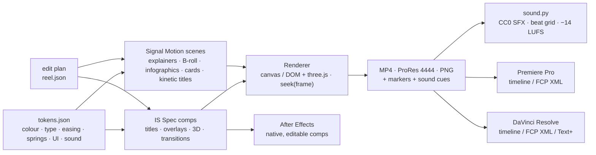

- **Deterministic.** Every frame is a pure function of time: no clocks, no `Math.random`, no CSS transitions.
  Render a frame twice and you get the same pixels; render frames in any order.
- **Two engines, one plan.** IS Spec comps (canvas, layers + keyframes as data, rebuilt natively in After Effects)
  and Signal Motion scenes (DOM, springs, camera, cursor) render through the same CLI and sit in the same edit plan.
- **Springs in closed form.** A value that changes target many times is a sum of springs, so motion blur
  (`--blur N` subframes) and seamless loops come for free. [Engine guide →](docs/MOTION-ENGINE.md)
- **One source of truth.** [`tokens/ink-signal.tokens.json`](tokens/ink-signal.tokens.json) holds every colour, font,
  easing curve, spring, UI radius, chart rule and sound gain. Change the accent once and every scene follows.
- **Real footage, real sound.** Clips are pre-extracted to frame-exact image sequences; sounds are recorded CC0
  files placed on cue frames and measured on the exported file.

## The system

<p align="center">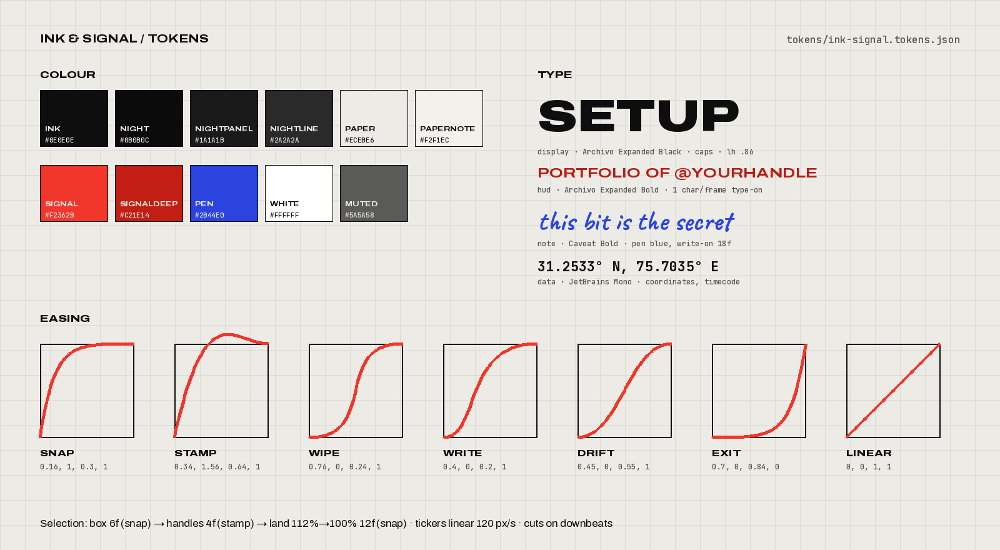</p>

**Brand layer** — square devices: the selection box, tickers, HUD corners, signal plates, handwriting with arrows,
the glyph trio. **Interface layer** (v3) — product UI rebuilt in the brand: white surfaces with a rule border and a
soft shadow on paper (raised panels on night), Archivo for UI, JetBrains Mono for code and numbers, Lucide line icons
at one stroke, rounded corners only here.

| Beat | Timing | Motion |
|---|---|---|
| Selection box draws → handles pop → title lands 112 → 100 % | 6 · 4 · 12 frames | `snap`, `stamp` (the only overshoot) |
| The one shape morphs between states | ~0.5 s | spring `morph` (ω 15, ζ .84) |
| Content swaps inside it | out 0.07 s · in 0.26 s, 12 px blur | never a cross-fade |
| Moving indicator | leading edge `fast`, trailing edge `slow` | it stretches like liquid |
| Camera push / ride / pull back | 1.0 / follow / 0.9 s | spring `camera` (no overshoot) |
| Cursor | arrives 0.3 s before a click, press 0.14 s, ripple 0.55 s | constant size at every zoom |
| Typing / HUD type-on | 25 cps / 1 frame per character | linear |
| Ticker | 120 px/s forever | linear, never eases |

**Rules.** One loud colour. Titles are one or two words in Archivo Expanded Black. Big moves on beats, type on 1/16
notes, cuts on downbeats; in calm pieces the camera is the editor. Transitions are objects. Real numbers only.
No gradients on type, glows, lens flares, RGB split, camera shake, emoji or bouncy cameras. The full spec is in
[`docs/MOTION-SPEC.md`](docs/MOTION-SPEC.md); structures for reels, YouTube and SaaS explainers in
[`docs/RECIPES.md`](docs/RECIPES.md).

### 3D

Extruded type with signal-red faces and ink sides, a long lens (28°), a key light from the top-left, and the selection
gizmo as the hero device. Scenes: `gizmoTitle`, `popupPaper`, `tickerRing`, `polaroidFlythrough`, `paperRoll`, and the
cube field inside `x-hype`.

## The edit plan

Clips, IS Spec comps and motion scenes in one timeline; motion scenes work as items, overlays and transitions.

```json
{
  "name": "launch-reel", "format": "reel", "fps": 30, "accent": "#F2362B",
  "audio": { "music": "music/track.mp3", "musicGainDb": -9, "lufs": -14 },
  "snap": "downbeat",
  "timeline": [
    { "type": "comp", "comp": "t-countdown", "params": { "word": "Ship" } },
    { "type": "transition", "comp": "tr-bars" },
    { "type": "clip", "src": "clips/talk.mp4", "in": 4.2, "out": 9.8,
      "overlays": [ { "comp": "ov-captions", "params": { "words": [ { "text": "First", "start": 0.1, "end": 0.45 } ] } } ] },
    { "type": "comp", "comp": "ig-counter", "params": { "value": 12400, "label": "signups in week one" } },
    { "type": "transition", "comp": "tr-flood" },
    { "type": "comp", "comp": "chapter", "duration": 2.4, "params": { "title": "Setup", "src": "clips/desk.mp4" } },
    { "type": "comp", "comp": "endcard", "duration": 3 }
  ]
}
```

## After Effects · Premiere Pro · DaVinci Resolve

```bash
node render/nle.mjs plan.json --out pkg   # renders/ (ProRes 422 HQ, 4444 + alpha) · manifest.json · timeline.xml · edit.spec.json · plates/
```

| | No scripting | Scripted or through an MCP server |
|---|---|---|
| **After Effects** | Import `pkg/renders/*.mov` | `$.evalFile(".../InkSignal.jsx"); InkSignal.buildFromPackage("/abs/pkg")` rebuilds IS Spec comps as **native, editable comps** (text layers, shape layers, keyframes with the exact curves); motion scenes arrive as ProRes footage layers in place |
| **Premiere Pro** | File › Import › `pkg/timeline.xml` | `InkSignalPPro.assemble("/abs/pkg")` through the MCP's ExtendScript tool |
| **DaVinci Resolve** | File › Import › Timeline › `pkg/timeline.xml` | `assemble("/abs/pkg")` through the MCP's Python tool · `add_title("Setup")` for native Fusion Text+ |

Motion overlays and transitions land on their own tracks with alpha and markers. Details:
[`integrations/after-effects`](integrations/after-effects) · [`integrations/premiere-pro`](integrations/premiere-pro) ·
[`integrations/davinci-resolve`](integrations/davinci-resolve).

## Build your own scene

```js
import { defineScene } from '../scene.js';
import { morph } from '../morph.js';
import { segmented } from '../ui.js';

export const mbExample = defineScene({
  name: 'mb-example', kind: 'broll', title: 'Example', formats: ['yt', 'reel'],
  defaults: { at: { card: 1.2, click: 2.4 }, end: 4 },
  duration: (p) => p.end,
  build(ctx) {
    const { S, p } = ctx;
    const m = ctx.add(morph(S, { states: { pill: { w: 420, h: 110, r: 55, bg: 'control', cam: 1.8 },
                                          card: { w: 900, h: 320, r: 40, bg: 'surface', cam: 1.4 } },
                                 start: 'pill', seq: [[p.at.card, 'card']] }));
    ctx.add(segmented(S, m.layer({ tin: p.at.card }), { items: ['Low', 'High'], index: [[p.at.click, 1]] }));
    ctx.cursor({ keys: [[0, 500, 300], [p.at.click - 0.25, 115, 0], [p.end, 200, 120]], clicks: [p.at.click] });
  },
});
```

The engine: springs, tracks, keyframes, swaps, cursor paths, typing, counters, beat grids, baked physics, slow-mo
(`engine.js`) · stage, camera and rooms · the one-shape `morph` · a UI kit of 25 components · charts · kinetic type ·
brand effects. [Guide →](docs/MOTION-ENGINE.md)

## Layout

```
tokens/        ink-signal.tokens.json (source of truth) · tokens.css · icons.json (Lucide)
fonts/         Archivo (variable + Expanded), Caveat, JetBrains Mono (OFL) + 3D typeface
runtime/       IS Spec: core · spec · components · render2d · player · three/ · comps/ · gsap-bridge
runtime/motion Signal Motion: engine · dom · stage · rooms · morph · cursor · ui · charts · type · fx · scenes/
stage/         index.html (IS Spec) · motion.html (motion scenes, scrubbable preview)
render/        cli.mjs · build-reel.mjs · broll.mjs · cues.mjs · sound.py · beats.py · nle.mjs · serve.mjs
sound/         sfx/ (103 CC0 sounds + manifest) · LICENSES.md · MUSIC.md
skills/        ink-signal-reels · ink-signal-explainer · ink-signal-broll · ink-signal-sound
integrations/  after-effects/ · premiere-pro/ · davinci-resolve/
docs/          CATALOG · MOTION-SPEC · MOTION-ENGINE · EXPLAINERS · BROLL · SOUND · RECIPES · library.html
templates/     review.html (B-roll review page)
tools/         build.py · catalog.mjs · words.py · inspect_video.py · separate.py · readme_gifs.mjs · ttf_to_typeface.py
```

After editing the tokens, run `python3 tools/build.py`; after adding a scene, `node tools/catalog.mjs`.

## Credits & licence

Code: MIT. v3's motion vocabulary, B-roll method, explainer structures, object separation and sound pass build on
[Barty-Bart/motion-graphics](https://github.com/Barty-Bart/motion-graphics) (MIT), rewritten for this system; its CC0
sound library ships in `sound/sfx/` (Kenney and Freesound, per-file credits in
[`sound/LICENSES.md`](sound/LICENSES.md)); the sound-pass method is credited to Vox (@Voxyz_ai). Icons:
[Lucide](https://lucide.dev) (ISC). Fonts: [Archivo](https://github.com/Omnibus-Type/Archivo),
[Caveat](https://github.com/googlefonts/caveat) and [JetBrains Mono](https://github.com/JetBrains/JetBrainsMono),
SIL Open Font License 1.1. [three.js](https://threejs.org) (MIT). [GSAP](https://gsap.com) (GreenSock standard
no-charge licence). Rendering pipeline ideas from
[awesome-opus5-5-videos](https://github.com/yihui-dev/awesome-opus5-5-videos). The visual language was inspired by
Raagav Sundar's *Graphic Design Portfolio 2026* on Behance; no artwork from it is included. Full notices:
[`THIRD_PARTY_NOTICES.md`](THIRD_PARTY_NOTICES.md).
